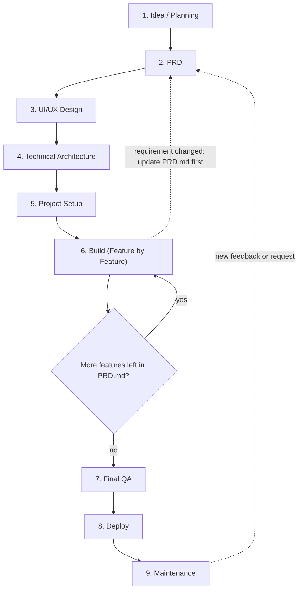
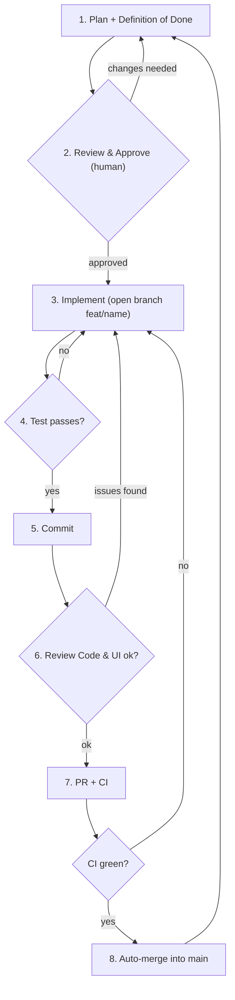

# AGENTS.md

## Project
- Name: [PROJECT_NAME]
- Goal (one sentence): [WHO] can [DO WHAT] without [PAIN]
- Source of truth: `PRD.md` (what to build), `ARCHITECTURE.md` (how it is built)

## Stack
- Source of truth for stack, folder structure and coding conventions: the **`nextjs-production-stack` skill** (installed either in the project's `.agents/skills/nextjs-production-stack/` or globally in `~/.gemini/config/skills/nextjs-production-stack/`). Read it before planning or writing any code.
- Summary: Next.js App Router + TypeScript strict, pnpm, Tailwind + shadcn/ui, React Hook Form + Zod, PostgreSQL + Drizzle, Better Auth, Vitest + Playwright, Sentry, GitHub Actions + Vercel.
- These tools are recommended, not strict (user preference). Before changing, replacing, or skipping any, ask the user first and offer options (see `nextjs-production-stack` skill section 0). Until answered, keep the recommended default.
- Default package manager is pnpm. Never mix package managers in one project.
- DB: PostgreSQL + Drizzle on Neon is the recommended default for new projects, or after an approved migration.
- **Existing projects mostly run MongoDB. Never migrate to PostgreSQL + Drizzle + Neon without asking first.** Ask with options (keep MongoDB, migrate gradually, or one planned full migration), with tradeoffs and your recommendation. Until answered, do not touch the database layer.

## Project Mode (decide first)
- **New project:** start at Main Flow step 1 and use every step.
- **Existing project:** do not run the Setup scaffold. First do a read-only audit (change no code): read the codebase, compare it with the `nextjs-production-stack` skill, write `ARCHITECTURE.md` (current state) and `PRD.md` (current features, plus each gap as its own feature: package manager, database, auth, tests, CI, Sentry). Then use the Feature Flow for every change. Match existing patterns, and ask before each tool or database change.

## Workflow Diagrams

### Main Flow (once per project, top to bottom)

### Feature Flow (repeat for every feature inside Build)

Fix is not a separate step. Any failure (Test, Review, CI) sends you back to Implement.

## Code Rules
- Clean, modular code. One responsibility per file.
- No `any`. Type everything.
- Follow folder structure in `ARCHITECTURE.md`. Do not invent new top-level folders.
- Never hardcode secrets. Use `.env` only. `.env` must stay in `.gitignore`.
- Validate all user input on the server with Zod.
- Follow the `nextjs-production-stack` skill. If it conflicts with existing project code, match the existing code and note the deviation in the plan.

## Commands
- Lint: `pnpm lint`
- Type check: `pnpm exec tsc --noEmit`
- Unit tests: `pnpm test` (Vitest, script must be `vitest run`)
- E2E tests: `pnpm exec playwright test` (larger changes only)
- Build: `pnpm build`
- Full check (run before every commit): `pnpm lint && pnpm exec tsc --noEmit && pnpm test`

## Main Flow Details

1. **Idea / Planning:** one sentence: who, what problem. Ask the human questions until it is sharp.
2. **PRD:** write `PRD.md` (one page): MVP feature list, later list.
3. **UI/UX Design:** screens and user flow (wireframe or AI-generated screens).
4. **Technical Architecture:** write `ARCHITECTURE.md`: Drizzle DB tables, user roles (RBAC), folder structure per the `nextjs-production-stack` skill.
5. **Project Setup (once):** scaffold per `nextjs-production-stack` skill section 1 (`pnpm create next-app@latest`, shadcn init), this file, ESLint + Prettier, Zod-validated env (`lib/env.ts`), `.env` in `.gitignore`, `test` script = `vitest run`, CI (install, lint, typecheck, test, build), Sentry, Vercel preview URL.
6. **Build:** run the Feature Flow below for each feature in `PRD.md`, one at a time.
7. **Final QA:** see checklist at the bottom.
8. **Deploy:** preview first, then production. Keep rollback ready.
9. **Maintenance:** error monitoring (e.g. Sentry). New requests go into `PRD.md`, then Feature Flow.

## Feature Flow Details (mandatory for every feature)

### 1. Plan
- Read `PRD.md` and `ARCHITECTURE.md`. In a large or old codebase, read the relevant files first.
- Write a short plan: files to change, what changes in each.
- Write **Definition of Done**: 2-4 testable sentences.
  Example: "Submitting the form saves the order to DB and shows it in the list."

### 2. Review & Approve
- **STOP. Wait for human approval. Do not write code before approval.**

### 3. Implement
- Run `git checkout -b feat/<short-name>`. Never work on `main`.
- Follow section 15 (Working conventions) of the `nextjs-production-stack` skill: extend existing schema/actions/components, new form = Zod schema -> React Hook Form -> Server Action with auth check, new route = decide static vs dynamic, add `loading.tsx`, `error.tsx`, metadata.
- Write the code AND tests that prove each Definition of Done line.
- Do only what the approved plan says. If scope must change, stop and ask.

### 4. Test
- Run the full check. If anything fails, fix and re-run.
- Never skip or delete tests to make them pass.

### 5. Commit
- Only after tests pass: `git add -A && git commit -m "feat(orders): add order form"` (conventional, scoped messages: feat, fix, chore, refactor)
- Small, clear messages. Fixes after review or CI = new commits.

### 6. Review Code & UI
- Use a separate reviewer agent (fresh context) to review `git diff main`. Check: bugs, security, missing tests, unused code, plan mismatch.
- Fix every real issue (back to Implement), then Test again.
- UI feature: share the preview URL and **wait for the human to check it on mobile.**

### 7. PR + CI
- `git push -u origin HEAD`
- `gh pr create --fill`
- CI must run: install, lint, typecheck, unit tests, build (add e2e for larger changes).

### 8. Auto-merge
- Backend / logic feature: `gh pr merge --auto --squash --delete-branch`
- UI feature: only after the human says OK.
- CI fails: back to Implement. Never merge on red CI.

### Loop
- `git checkout main && git pull`, then pick the next feature from `PRD.md` and start at Plan.

## Never Do
- Never commit directly to `main`.
- Never commit `.env`, keys, or tokens.
- Never merge with failing CI.
- Never change requirements silently. Update `PRD.md` first, then ask for approval.
- Never add a library without saying why in the plan.
- Never migrate the database (e.g. MongoDB to PostgreSQL) without explicit approval.

## Final QA Checklist (before deploy)
- Full user flow works end to end on mobile.
- No secrets in repo or logs.
- Login / permissions work as intended.
- Inputs are validated with Zod and every Server Action checks authorization.
- Security headers are set. Sentry receives a test error. Production DB has a backup.
