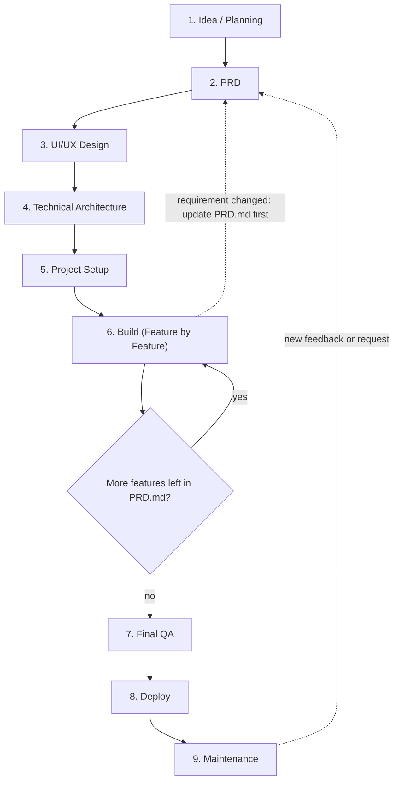
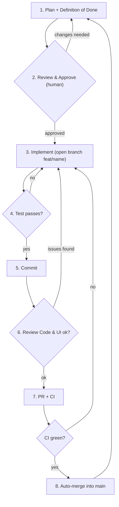

# Workflow

Human-readable diagrams for the two flows defined in [`../AGENTS.md`](../AGENTS.md).
**`AGENTS.md` is normative** — if a diagram and its text disagree, follow the text.

## Main Flow (once per project, top to bottom)

## Feature Flow (repeat for every feature inside Build)

Fix is not a separate step: any failure (test, review, CI) sends you back to Implement.
